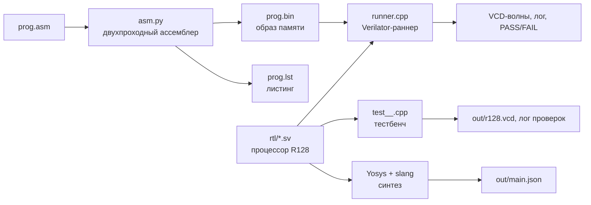
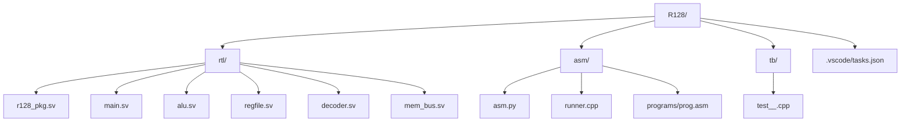
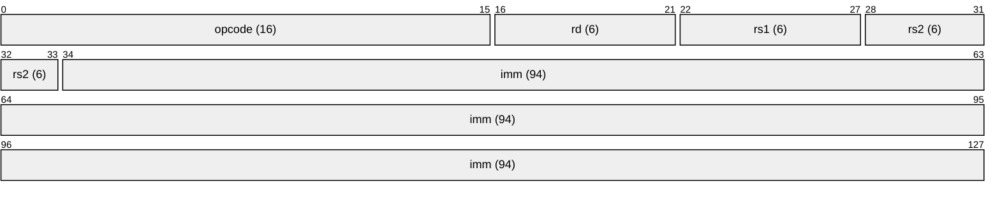
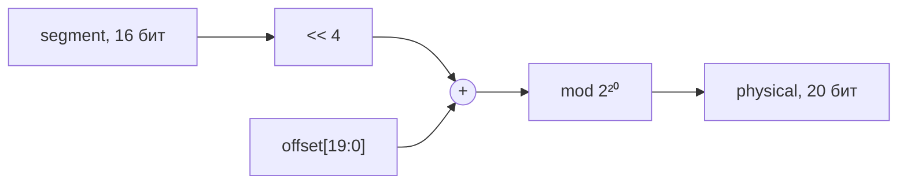
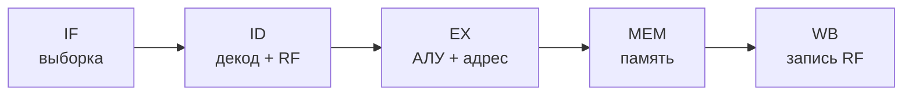
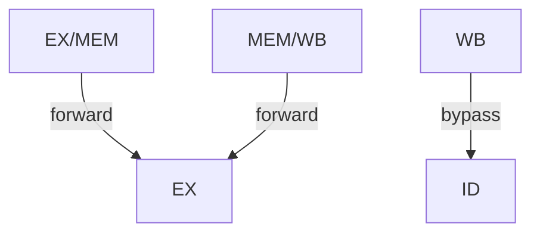

# R128

**R128** — учебный 128-битный процессор на SystemVerilog с полным набором инструментов:
двухпроходный ассемблер на Python, симулятор-раннер на Verilator/C++, большой самопроверяющийся
тестбенч и демонстрационная программа.

Процессор сочетает идеи классических архитектур:

- **сегментную адресацию в стиле Intel 8086** (`физический адрес = сегмент × 16 + смещение`);
- **классический 5-стадийный RISC-конвейер** (IF → ID → EX → MEM → WB, `r0 ≡ 0`, forwarding);
- **фиксированный 128-битный формат инструкции** и 128-битные регистры общего назначения.



---

## Содержание

1. [Ключевые характеристики](#1-ключевые-характеристики)
2. [Быстрый старт](#2-быстрый-старт)
3. [Структура репозитория](#3-структура-репозитория)
4. [Архитектурные влияния и сравнение](#4-архитектурные-влияния-и-сравнение)
5. [Архитектура набора команд (ISA)](#5-архитектура-набора-команд-isa)
6. [Справочник инструкций](#6-справочник-инструкций)
7. [Микроархитектура](#7-микроархитектура)
8. [Интерфейс верхнего модуля](#8-интерфейс-верхнего-модуля)
9. [Ассемблер](#9-ассемблер)
10. [Симулятор-раннер](#10-симулятор-раннер)
11. [Верификация](#11-верификация)
12. [Демонстрационная программа](#12-демонстрационная-программа)
13. [Синтез](#13-синтез)
14. [Известные ограничения](#14-известные-ограничения)
15. [Глоссарий](#15-глоссарий)

---

## 1. Ключевые характеристики

| Параметр | Значение |
|---|---|
| Ширина данных / регистров | 128 бит |
| Регистры общего назначения | 64 × 128 бит (`r0`…`r63`), `r0` всегда читается как 0 |
| Длина инструкции | фиксированная, 128 бит (16 байт) |
| Количество инструкций | 40 опкодов (`0x0000`…`0x0027`) |
| Конвейер | 5 стадий: IF → ID → EX → MEM → WB |
| Разрешение конфликтов данных | forwarding EX/MEM→EX, MEM/WB→EX, WB→ID |
| Разрешение конфликтов управления | переход решается в EX, затем flush IF/ID и ID/EX |
| Счётчик команд (PC) | 16 бит, выравнивание по 16 байт (младшие 4 бита всегда 0) |
| Физический адрес | 20 бит (1 МиБ адресного пространства) |
| Сегментные регистры | CS, DS, SS, ES (по 16 бит) |
| Формула адреса | `phys = (seg << 4) + offset[19:0]` (mod 2²⁰) |
| Порты ввода-вывода | 256 портов × 128 бит |
| Память | единая (фон Нейман), handshake `memReq` / `memReady` |
| Язык реализации | SystemVerilog |
| Инструменты | Verilator, Python 3, Yosys + slang (опционально) |

---

## 2. Быстрый старт

### 2.1. Требования

- Python 3.8+
- Verilator (рекомендуется ≥ 5.0)
- C++17-совместимый компилятор (`g++` / `clang++`)
- (опционально) Yosys с плагином `slang` для синтеза
- (опционально) Surfer / GTKWave для просмотра волн

### 2.2. Ассемблирование демо-программы

```bash
python3 asm/asm.py asm/programs/prog.asm \
    -o asm/programs/prog.bin \
    --listing asm/programs/prog.lst
```

### 2.3. Сборка и запуск раннера

```bash
mkdir -p out
verilator --cc --trace --exe --build -j 0 \
    -Mdir out/obj_dir -o r128_runner \
    asm/runner.cpp $(find rtl -name '*.sv' | sort) \
    --top-module main

cp -f out/obj_dir/r128_runner out/r128_runner
./out/r128_runner asm/programs/prog.bin --input 10 --latency 1
```

Успешный прогон заканчивается выводом кода `0x5238` («R128») на порт 7.

### 2.4. Полный тестбенч

```bash
mkdir -p out
verilator --cc --trace --exe --build -j 0 \
    -Mdir out/obj_dir -o Vmain \
    tb/test__.cpp $(find rtl -name '*.sv' | sort) \
    --top-module main

./out/obj_dir/Vmain
# ожидаемый итог: "==== TOTAL: N passed, 0 failed ====" / "RESULT: OK"
```

### 2.5. Просмотр волн

```bash
surfer asm/programs/prog.vcd      # или gtkwave
surfer out/r128.vcd
```

### 2.6. Синтез (Yosys + slang)

```bash
mkdir -p out
yosys -m slang -p "read_slang --top main $(find rtl -name '*.sv' | sort | tr '\n' ' '); \
                   synth -top main; write_json out/main.json"
```

### 2.7. Задачи VS Code

| Задача | Действие |
|---|---|
| Assemble (current .asm) / Assemble (prog.asm) | ассемблирование |
| Build Runner (Verilator) | сборка `out/r128_runner` |
| Run Program / Assemble & Run | запуск с параметрами |
| Open Waveform | открыть VCD |
| Build / Run Simulation (full testbench) | полный тестбенч |
| Synthesis (Yosys) | синтез |

---

## 3. Структура репозитория

```
R128/
├── README.md
├── .gitignore
├── .vscode/
│   └── tasks.json          # задачи сборки, запуска, синтеза
├── rtl/
│   ├── r128_pkg.sv         # опкоды, сегменты, функции ISA
│   ├── main.sv             # конвейер, forwarding, управление, I/O
│   ├── alu.sv              # 128-битное АЛУ и флаги
│   ├── regfile.sv          # 64 × 128 бит, r0 ≡ 0
│   ├── decoder.sv          # нарезка 128-битной инструкции
│   └── mem_bus.sv          # арбитр шины IF и данных
├── asm/
│   ├── asm.py              # двухпроходный ассемблер
│   ├── runner.cpp          # Verilator-раннер + модель памяти
│   └── programs/
│       └── prog.asm        # демонстрационная программа
└── tb/
    └── test__.cpp          # самопроверяющийся тестбенч
```



---

## 4. Архитектурные влияния и сравнение

R128 — собственная учебная архитектура. Ниже — откуда взяты идеи и чем она отличается от современных процессоров.

| Идея в R128 | Источник | Что отличается |
|---|---|---|
| Сегментная адресация `phys = seg·16 + off`, 20-битный физический адрес, CS/DS/SS/ES | **Intel 8086** (реальный режим) | Нет префиксов переопределения сегмента; нет A20-маскирования; сумма просто обрезается до 20 бит |
| Дальний переход `JMPF`, запись в CS сбрасывает конвейер | `JMP FAR` / `MOV CS` в x86 | Сегмент задаётся непосредственным значением |
| Мнемоники условных переходов и наборы «выше/ниже» / «больше/меньше» | **x86** | Явные имена `JUGT/JULT/...` и `JSGT/JSLT/...` |
| Отдельное пространство портов `IN`/`OUT` | **x86**, микроконтроллеры | 256 портов шириной 128 бит |
| 5-стадийный конвейер IF/ID/EX/MEM/WB, `r0 ≡ 0`, трёхадресные команды | **MIPS / RISC-V / DLX** | 64 регистра × 128 бит; очень длинная инструкция |
| Фиксированная длина инструкции, простой декодер из срезов | **RISC** | 128 бит на инструкцию, 94-битный immediate |
| Forwarding EX/MEM→EX и MEM/WB→EX | учебники (Паттерсон, Хеннесси) | — |
| Handshake памяти `memReq/memReady` | Wishbone / valid-ready | Один запрос в полёте |

### Сравнение с современными архитектурами

| Аспект | R128 (учебный) | RISC-V (RV64I) | x86-64 | ARM AArch64 |
|---|---|---|---|---|
| Ширина регистров | 128 бит | 64 бит | 64 бит | 64 бит |
| Число GPR | 64 (`r0`=0) | 32 (`x0`=0) | 16 | 31 |
| Длина инструкции | фиксированная 128 бит | 16/32 бит (C) | 1–15 байт | фиксированная 32 бит |
| Адресация | сегментная 20 бит | линейная 64 бит | плоская + сегменты (редко) | плоская 64 бит |
| Конвейер | простой 5-стадийный in-order | in-order / OoO | глубокий OoO | глубокий OoO |
| Предназначение | обучение конвейеру, ISA, сегментации | реальные системы | совместимость | мобильные / серверные |

R128 **намеренно упрощён**: нет MMU, кэшей, предсказателя переходов, исключений, суперскалярности и out-of-order. Это позволяет сосредоточиться на базовых механизмах конвейера и сегментной модели памяти.

---

## 5. Архитектура набора команд (ISA)

### 5.1. Формат инструкции

Все инструкции имеют фиксированную длину **128 бит** (16 байт):



| Поле | Биты | Назначение |
|---|---|---|
| `opcode` | [127:112] | код операции |
| `rd` | [111:106] | регистр назначения (или служебное поле) |
| `rs1` | [105:100] | первый источник |
| `rs2` | [99:94] | второй источник |
| `imm` | [93:0] | непосредственный операнд / смещение / порт / сегмент |

### 5.2. Регистры

- **64 регистра общего назначения** `r0`…`r63`, каждый 128 бит.
- `r0` при чтении **всегда** даёт 0; запись в `r0` игнорируется.
- **Сегментные регистры**: `CS`, `DS`, `SS`, `ES` (по 16 бит).
- **Флаги** (32-битный вектор, используются биты 0…14).

### 5.3. Адресация памяти



- Выборка инструкции: `segment = CS`, `offset = PC`.
- `LOAD` / `STORE`: `segment = DS`, `offset = (rs1 + sign_extend(imm))[19:0]`.
- `LOADS` / `STORES`: сегмент выбирается селектором (`CS/DS/SS/ES`).

### 5.4. Флаги

| Бит | Имя | Смысл |
|---|---|---|
| 0 | Z | результат == 0 |
| 1 | N | старший бит результата |
| 2 | C | перенос / «нет заимствования» / вытесненный бит сдвига |
| 3 | V | знаковое переполнение |
| 4 | VALID | флаги получены от известной операции |
| 5–14 | EQ, NE, UGT, ULT, UGE, ULE, SGT, SLT, SGE, SLE | результаты сравнения |

Флаги обновляют: `ADD SUB AND OR XOR NOT SHL SHR CMP`.  
Остальные инструкции флаги **не меняют**.

---

## 6. Справочник инструкций

### Арифметика и логика

| Мнемоника | Opcode | Семантика |
|---|---|---|
| `NOP` | `0x0000` | нет операции |
| `ADD  rd, rs1, rs2` | `0x0001` | `rd ← rs1 + rs2` |
| `SUB  rd, rs1, rs2` | `0x0002` | `rd ← rs1 − rs2` |
| `AND  rd, rs1, rs2` | `0x0003` | `rd ← rs1 & rs2` |
| `OR   rd, rs1, rs2` | `0x0004` | `rd ← rs1 \| rs2` |
| `XOR  rd, rs1, rs2` | `0x0005` | `rd ← rs1 ^ rs2` |
| `NOT  rd, rs1` | `0x0006` | `rd ← ~rs1` |
| `SHL  rd, rs1, rs2` | `0x0007` | `rd ← rs1 << rs2[6:0]` |
| `SHR  rd, rs1, rs2` | `0x0008` | `rd ← rs1 >> rs2[6:0]` (логический) |
| `MOV  rd, rs1` | `0x0009` | `rd ← rs1` |
| `CMP  rs1, rs2` | `0x0020` | вычисляет `rs1 − rs2`, обновляет только флаги |

### Память

| Мнемоника | Opcode | Семантика |
|---|---|---|
| `LOAD  rd, rs1, imm` | `0x000A` | `rd ← Mem[DS:(rs1+imm)]` |
| `STORE rs1, rs2, imm` | `0x000B` | `Mem[DS:(rs1+imm)] ← rs2` |
| `LOADS rd, rs1, seg, imm` | `0x0023` | `rd ← Mem[seg:(rs1+imm)]` |
| `STORES seg, rs1, rs2, imm` | `0x0024` | `Mem[seg:(rs1+imm)] ← rs2` |

### Управление

| Мнемоника | Opcode | Семантика |
|---|---|---|
| `JMP   label` | `0x000C` | `PC ← PC_инструкции + sign_extend(imm)`, арифметика по модулю 2¹⁶, результат выравнивается по 16 байт. Смещение отсчитывается от адреса самой `JMP`, а не от `PC+16`; ассемблер кладёт в `imm` значение `label − адрес_JMP` |
| `JMPF  seg, off` | `0x0025` | `CS ← seg; PC ← off` (дальний переход). Кодирование: `imm[15:0]` = новый CS, `imm[31:16]` = новый PC (младшие 4 бита PC обнуляются) |
| `HALT` | `0x000D` | останов процессора |

### Условные переходы

Все условные переходы адресуются так же, как `JMP`: относительно адреса самой инструкции перехода.
Условие вычисляется по самым свежим флагам с учётом forwarding из EX/MEM и MEM/WB.

| Мнемоника | Условие |
|---|---|
| `JZ / JNZ` | Z / ~Z |
| `JN / JP` | N / ~N |
| `JC / JNC` | C / ~C |
| `JV / JNV` | V / ~V |
| `JE / JNE` | EQ / NE |
| `JUGT / JULT / JUGE / JULE` | беззнаковые сравнения |
| `JSGT / JSLT / JSGE / JSLE` | знаковые сравнения |

### Сегменты и ввод-вывод

| Мнемоника | Opcode | Семантика |
|---|---|---|
| `MOVS seg, rs1` | `0x0021` | запись сегментного регистра |
| `MFS  rd, seg` | `0x0022` | чтение сегментного регистра |
| `IN   rd, port` | `0x0026` | `rd ← IO[port]` |
| `OUT  rs1, port` | `0x0027` | `IO[port] ← rs1` |

---

## 7. Микроархитектура

### 7.1. Конвейер



- **IF** — формирование физического адреса по CS:PC, запрос к памяти, ожидание `memReady`.
- **ID** — декодирование полей, чтение регистрового файла, подготовка операндов.
- **EX** — АЛУ, вычисление адреса, решение о переходе, формирование флагов.
- **MEM** — доступ к данным (LOAD/STORE), ожидание `memReady`.
- **WB** — запись результата в регистровый файл.

### 7.2. Forwarding



Поддерживаются пути:
- EX/MEM → EX (результат предыдущей арифметики или данные LOAD после `memReady`);
- MEM/WB → EX;
- обход WB → ID.

При конфликте LOAD → использующая инструкция конвейер **приостанавливается** до готовности данных.

### 7.3. Конфликты управления

Переход вычисляется в стадии EX. При taken-переходе выполняется **flush** регистров IF/ID и ID/EX. Запись в `CS` (`MOVS CS` / `JMPF`) также сбрасывает конвейер.

### 7.4. Арбитраж памяти

Инструкции и данные делят одну шину. При одновременном запросе IF и данных приоритет у **данных**; IF приостанавливается.

---

## 8. Интерфейс верхнего модуля

Модуль `main` имеет следующий интерфейс:

```systemverilog
module main (
    input  logic         clk,
    input  logic         rst,

    // Память (фон Нейман)
    output logic         memReq,
    output logic         memRe,
    output logic         memWe,
    output logic [19:0]  memAddr,
    output logic [127:0] memWData,
    input  logic         memReady,
    input  logic [127:0] memRData,

    // Ввод-вывод (256 портов × 128 бит)
    input  logic [127:0] ioInData,
    output logic         ioInRead,
    output logic [7:0]   ioInPort,
    output logic         ioOutWrite,
    output logic [7:0]   ioOutPort,
    output logic [127:0] ioOutData,

    // Отладочный выход PC
    output logic [63:0]  pcOut
);
```

Протокол памяти: процессор выставляет `memReq` + адрес/данные и ждёт `memReady`. Пока `memReady = 0`, соответствующие стадии конвейера стоят.

---

## 9. Ассемблер

Файл `asm/asm.py` — двухпроходный ассемблер на чистом Python 3.

```bash
python3 asm/asm.py source.asm -o out.bin --listing out.lst
python3 asm/asm.py source.asm --hex --symbols
```

Поддерживается:
- все 40 инструкций ISA;
- метки и выражения вида `метка ± число`;
- директивы `.org`, `.align`, `.byte`, `.word`, `.word128`, `.fill`;
- листинг (`--listing`), таблица символов (`--symbols`) и hex-дамп (`--hex`);
- сообщения об ошибках с номером строки.

Соглашения кодирования переходов: для `JMP` и условных переходов ассемблер вычисляет
`imm = метка − адрес_текущей_инструкции`. Числовой операнд трактуется как готовое смещение.
Для `JMPF` в `imm[15:0]` кладётся сегмент CS, в `imm[31:16]` — смещение PC.

---

## 10. Симулятор-раннер

`asm/runner.cpp` вместе с Verilator загружает `.bin`-образ в модель памяти, подключает простую модель задержки памяти и портов I/O, пишет VCD и покадровый лог.

```bash
./out/r128_runner program.bin \
    --input 10 \
    --latency 1 \
    --max-cycles 200000 \
    --vcd waves.vcd \
    --log run.log
```

| Параметр | Смысл | По умолчанию |
|---|---|---|
| `--input` | значение, возвращаемое портами IN | 0 |
| `--latency` | задержка памяти в тактах | 1 |
| `--max-cycles` | лимит тактов симуляции | 200000 |
| `--vcd` / `--log` | пути к файлам | рядом с `.bin` |

---

## 11. Верификация

`tb/test__.cpp` — большой самопроверяющийся тестбенч. Он покрывает:

- сброс, NOP, HALT, неизвестный opcode;
- все операции АЛУ (включая старшую половину 128-битного результата);
- семантику `r0 ≡ 0`;
- цепочки forwarding и зависимости LOAD→ALU, ALU→STORE и т.д.;
- задержки памяти 0…8 тактов;
- арбитраж IF/данные;
- все условные переходы (taken / not-taken);
- JMP, JMPF, сегментные операции;
- `MOVS CS` и сброс конвейера, в том числе перебор 7 задержек памяти × 6 вариантов
  инструкций перед `MOVS` (проверка, что инструкция сразу за `MOVS CS` не теряется);
- протокол `memReq/memReady` и стробы IN/OUT;
- таймауты.

Запуск:

```bash
./out/obj_dir/Vmain
# ==== TOTAL: 1223 passed, 0 failed ====
# RESULT: OK
```

Число проверок меняется при добавлении тестов. Критерий успеха — `0 failed` и `RESULT: OK`.
Лог пишется в `tb/test__log.txt`, волны — в `out/r128.vcd`.

---

## 12. Демонстрационная программа

`asm/programs/prog.asm` демонстрирует основные возможности ISA:

1. Арифметику и логику + вывод результатов на порты.
2. Работу с флагами и условными переходами.
3. Обращение к памяти (`LOAD`/`STORE`).
4. Сегментные регистры (`MOVS`/`MFS`) и `LOADS`/`STORES`.
5. Дальний переход `JMPF` и финальный код успеха `0x5238` («R128») на порту 7.

При успешном выполнении на порту 7 появляется значение `0x00005238`.

---

## 13. Синтез

Технологически независимый синтез через Yosys + slang:

```bash
yosys -m slang -p "read_slang --top main $(find rtl -name '*.sv' | sort | tr '\n' ' '); \
                   synth -top main; write_json out/main.json"
```

Результат — нетлист `out/main.json` (и при желании схема в DOT/SVG).

---

## 14. Известные ограничения

- Нет MMU, виртуальной памяти, защиты, исключений и прерываний.
- Нет кэшей и предсказателя переходов.
- PC ограничен 16 битами → максимальный размер кода в одном сегменте ≈ 64 КБ.
- Физическое адресное пространство — 1 МиБ.
- Один запрос к памяти в полёте.
- Нет суперскалярности и out-of-order исполнения.
- SystemVerilog-часть не рассчитана на синтез в ПЛИС «из коробки» без дополнительной обвязки (память, тактовый домен и т.д.).

Эти ограничения сознательны: проект предназначен для изучения конвейера, forwarding, сегментной адресации и базовой верификации.

---

## 15. Глоссарий

| Термин | Значение |
|---|---|
| IF / ID / EX / MEM / WB | стадии конвейера |
| Forwarding (bypass) | передача результата без ожидания записи в регистровый файл |
| Flush | сброс части конвейера при taken-переходе |
| Сегмент | 16-битный регистр, базовый адрес = seg × 16 |
| Handshake | протокол `memReq` → … → `memReady` |
| r0 | регистр, жёстко читаемый как ноль |
| Opcode | 16-битный код операции в старших битах инструкции |

---

## Лицензия и использование

Проект учебный. Можно свободно использовать, модифицировать и распространять в образовательных целях.
